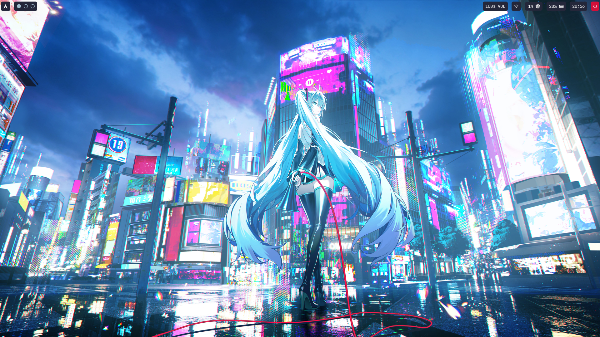
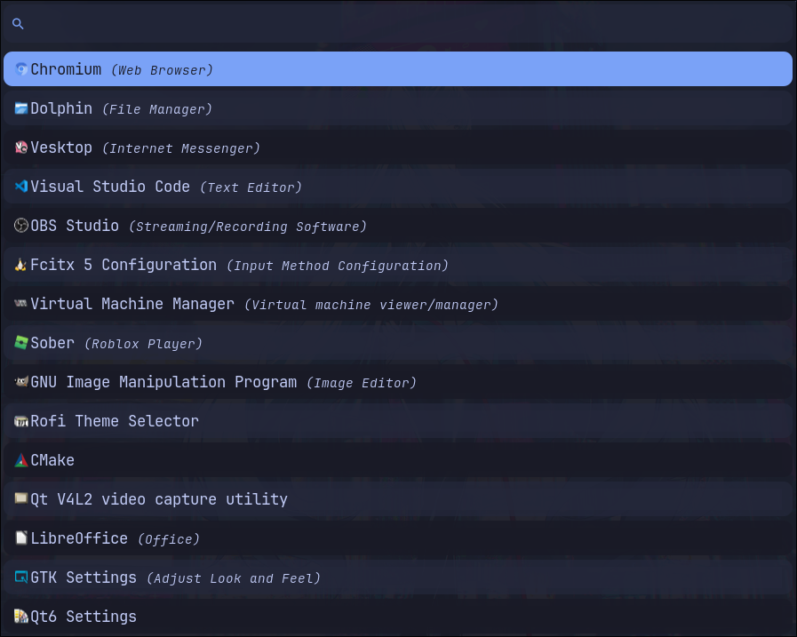
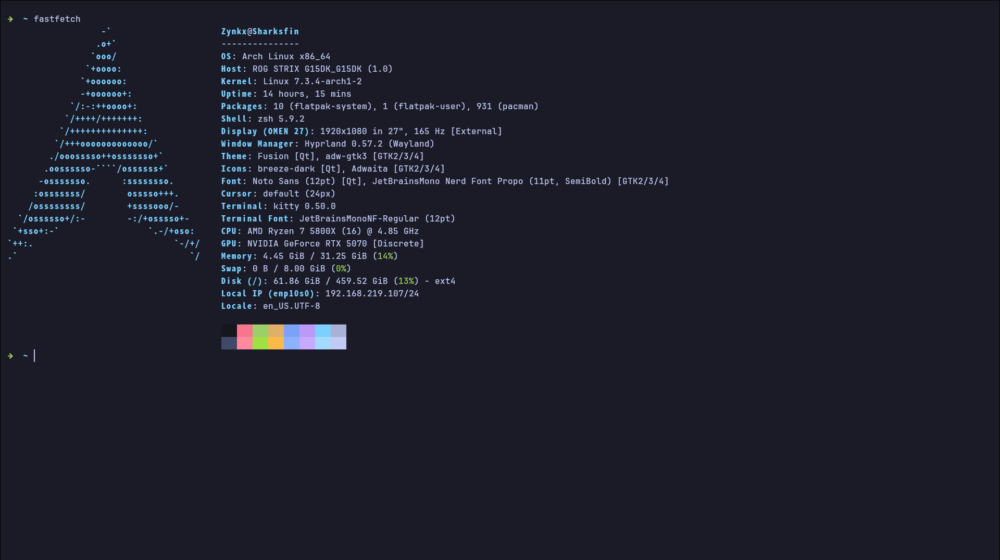

# Xzutll's Hyprland Dotfile
1. Dependencies
  - hyprland
  - waybar
  - rofi
  - dunst
  - kitty
  - dolphin
  - awww
  - nwg-look
  - zsh
  - qt6ct
  - paru
  - gimp
  - mpv
  - flatpak
  - fcitx5
  - fcitx5-configtool
  - fcitx5-hangul
  - pavucontrol
  - Jetbrains Mono Nerd
  - Noto Fonts CJK
  - xdg-desktop-portal-hyprland
  - hyprpolkitagent
  - pipewire
  - grim
  - slurp
  - swappy
  - xdg-desktop-portal-gtk
  - adw-gtk-theme
# 2. Installation
```shell
git clone https://github.com/xzutll/config && cd config && ./install.sh
```

# 3. Preview
Desktop



***
Rofi



***
Kitty



***
Waybar


